# Documentación Técnica, Científica y Académica — Simulador de Arquitecturas de Software (`EnRuta`)

**Universidad Libre — Facultad de Ingeniería**  
**Programa de Ingeniería de Sistemas | Curso: Ingeniería Aplicada**  
**Actividad 9: Construcción, Validación y Sustentación de un Simulador de Arquitecturas de Software**

- **Proyecto Objeto de Estudio:** `EnRuta` — Sistema Inteligente de Optimización de Rutas de Última Milla (Bogotá D.C., Colombia)
- **Ingenieros Autores:**
  - Juan Esteban Guerrero Vera
  - Santiago Casas Barreto
  - Jose Sebastian Villalba
- **Versión del Motor Matemático y API:** `1.0.0` (`enruta-architecture-simulator`)
- **URL Pública Interactiva (GitHub Pages + Móvil QR):** [https://teach1030.github.io/EnRuta/](https://teach1030.github.io/EnRuta/)

---

## Tabla de Contenido

1. [Contexto y Configuración del Proyecto EnRuta](#1-contexto-y-configuración-del-proyecto-enruta)
2. [Descripción y Comparabilidad de las 4 Alternativas de Arquitectura](#2-descripción-y-comparabilidad-de-las-4-alternativas-de-arquitectura)
3. [Variables de Entrada, Restricciones del Proyecto y Validación Defensiva](#3-variables-de-entrada-restricciones-del-proyecto-y-validación-defensiva)
4. [Modelo Matemático Completo, Parámetros Calibrados, Supuestos y Limitaciones](#4-modelo-matemático-completo-parámetros-calibrados-supuestos-y-limitaciones)
5. [Indicadores Cuantificables y Motor de Apoyo a la Decisión (MCDA-SAW + Pareto 3D)](#5-indicadores-cuantificables-y-motor-de-apoyo-a-la-decisión-mcda-saw--pareto-3d)
6. [Evidencia de Pruebas Automatizadas de Validación (CP-01 a CP-10)](#6-evidencia-de-pruebas-automatizadas-de-validación-cp-01-a-cp-10)
7. [Manual de Instalación, Dockerización, GitHub Pages y Código QR para el Salón](#7-manual-de-instalación-dockerización-github-pages-y-código-qr-para-el-salón)
8. [Guion de Sustentación (Requisito 12) y Protocolo de Validación en Aplicación Real](#8-guion-de-sustentación-requisito-12-y-protocolo-de-validación-en-aplicación-real)
9. [Referencias Científicas](#9-referencias-científicas)

---

## 1. Contexto y Configuración del Proyecto EnRuta

### 1.1 Problemática Real en Logística de Última Milla (Bogotá D.C.)

`EnRuta` es una plataforma tecnológica compuesta por una aplicación móvil nativa (`mobile/`, construida en **React Native 0.86.3 + Expo SDK 57 + TypeScript + Zustand**) y un backend transaccional (`backend/`, construido en **FastAPI Python 3.12 + SQLAlchemy 2.0 Async + PostgreSQL + Google Gemini Vision + Mapbox Geocoding v6 + Google OR-Tools**). Fue concebida para resolver tres cuellos de botella operativos que enfrentan diariamente los mensajeros y conductores independientes de última milla en Bogotá D.C.:

1. **Digitalización de guías físicas heterogéneas (Carga intensiva de E/S y Visión Artificial):** Durante la ventana matutina de alistamiento y cargue en bodegas (6:00 a.m. – 8:00 a.m. en zonas como Puente Aranda, Montevideo y Fontibón), cada conductor debe registrar entre 30 y 80 etiquetas impresas de operadores como *Servientrega*, *Coordinadora*, *Interrapidísimo*, *Envía*, *J&T Express* e *iMile*.
2. **Nomenclatura vial bogotana y entregas multi-cliente por portería (Carga transaccional CRUD):** Las direcciones presentan abreviaturas no estandarizadas (`Cll`, `Kra`, `Dg`, `Tv`, `Autonorte`) y complementos residenciales acoplados (`Torre 2 Int 4 Apto 1101`). Además, una misma coordenada física (`Stop`) agrupa múltiples destinatarios y paquetes (`StopClient` en relación $1:N$), cuyas entregas se confirman en ruta mediante gestos rápidos *swipe* (`PUT /api/v1/stops/{id}/estado`).
3. **Optimización combinatoria de secuencia de paradas (Carga intensiva de CPU):** Ordenar óptimamente $N_p$ paradas urbanas desde la ubicación GPS actual del conductor exige construir una matriz de distancias geodésicas Haversine de orden $O(N_p^2)$ y ejecutar el solver en C++ de **Google OR-Tools** (`PATH_CHEAPEST_ARC` + metaheurística `GUIDED_LOCAL_SEARCH` con nodo *dummy depot* para Open TSP).

### 1.2 Perfil Base de Configuración del Proyecto (Línea Base MVP)

| Atributo de Configuración | Valor de Referencia MVP (`REF_MVP_BOGOTA`) | Justificación en el Dominio de `EnRuta` |
| :--- | :--- | :--- |
| **Nombre del Sistema** | `EnRuta - Optimización Logística de Última Milla` | Plataforma real desarrollada en el curso. |
| **Usuarios Objetivo** | Conductores urbanos en Bogotá D.C. (30–80 paradas/día) | Flotas PyME y mensajeros independientes. |
| **Usuarios Esperados ($U_{\text{exp}}$)** | `50` conductores registrados (`35` concurrentes en pico) | Etapa semilla de validación comercial en Bogotá. |
| **Presupuesto Tope ($B_{\max}$)** | \$25.00 USD/mes | Restricción financiera estricta de proyecto universitario / pre-semilla. |
| **Latencia Máxima SLA ($L_{\max}$)** | `1500.0 ms` | Tiempo máximo tolerable en terreno bajo redes móviles 4G. |
| **Disponibilidad Mínima ($A_{\min}$)** | `99.00%` | Continuidad operativa durante la jornada diurna de reparto. |
| **Tamaño del Equipo ($E_{\text{team}}$)** | `3` ingenieros de software | Los tres autores del proyecto encargados de desarrollo y operación DevOps. |
| **Cifrado Obligatorio** | `True` (TLS en tránsito + secretos protegidos) | Protección de datos personales de destinatarios (Ley 1581 de 2012 - Habeas Data). |

---

## 2. Descripción y Comparabilidad de las 4 Alternativas de Arquitectura

Para garantizar una **comparación justa, isomorfa y trazable**, las cuatro arquitecturas candidatas resuelven exactamente los mismos cinco casos de uso funcionales del código real de `EnRuta`, variando únicamente su **estrategia de descomposición, aislamiento de procesos, ubicación del cómputo OCR y modelo de aprovisionamiento**:

```mermaid
flowchart TD
    subgraph A1["1. MONO_MVP (VPS Host Único)"]
        M1["App Expo RN"] --> M2["Uvicorn FastAPI In-Process (drivers + stops + norm + ocr + OR-Tools)"]
        M2 --> M3["PostgreSQL 16"]
    end

    subgraph A2["2. MONO_ASYNC_CONTAINER (Docker + Redis)"]
        W1["App Expo RN"] --> W2["Contenedor enruta-api (drivers + stops + norm)"]
        W2 --> W3["Contenedor redis-broker"]
        W3 --> W4["Contenedor enruta-worker (Gemini OCR + OR-Tools C++)"]
        W2 --> W5["PostgreSQL 16"]
        W4 --> W5
    end

    subgraph A3["3. MICRO_DOCKER (5 Microservicios por Réplica)"]
        D1["App Expo RN"] --> D2["api-gateway (Nginx L7)"]
        D2 --> D3["ms-auth-drivers"]
        D2 --> D4["ms-stops-bogota"]
        D2 --> D5["ms-ocr-vision"]
        D2 --> D6["ms-tsp-ortools (C++ Dedicado)"]
        D3 & D4 & D5 & D6 --> D7["postgres-postgis"]
    end

    subgraph A4["4. HYBRID_EDGE_SERVERLESS (Edge ML Kit + FaaS)"]
        H1["App Expo + ML Kit On-Device (85% OCR y Norm Local)"] --> H2["Cloud Run / FaaS Scale-to-Zero (CRUD + TSP + 15% Fallback OCR)"]
        H2 --> H3["Supabase PostgreSQL Pooler"]
    end
```



### 2.1 Mapeo Funcional contra los Módulos Reales de `EnRuta`

| Módulo Real en `EnRuta` | `MONO_MVP` (Monolito VPS) | `MONO_ASYNC_CONTAINER` (Docker + Workers) | `MICRO_DOCKER` (Microservicios Docker) | `HYBRID_EDGE_SERVERLESS` (Edge + FaaS) |
| :--- | :--- | :--- | :--- | :--- |
| `endpoints/drivers.py` + `core/security.py` (JWT, bcrypt, Google OAuth2, Guest) | Ejecutado en el mismo proceso Uvicorn (`0 ms` IPC). | Atendido por el contenedor `enruta-api` con imagen compartida. | Desacoplado en `ms-auth-drivers` detrás de `api-gateway`. | Función efímera stateless en Cloud Run + validación JWT ligera. |
| `endpoints/stops.py` + `services/stop_service.py` (`Stop` $1:N$ `StopClient`, swipes) | Transacción SQLAlchemy directa en memoria local. | Atendido sin bloqueo por `enruta-api` sobre pool `asyncpg`. | Servicio dedicado `ms-stops-bogota` con esquema propio. | Contenedor FaaS conectado mediante `Supavisor` / `PgBouncer`. |
| `utils/normalization.py` (Regex vial Bogotá `Cll/Kra/Dg/Tv`, `Torre/Apto`) | Función Python síncrona llamada in-process tras el OCR. | Ejecutada en `enruta-api` (altas manuales) y `enruta-worker` (OCR). | Encapsulada dentro del dominio `ms-stops-bogota`. | **Portada a TypeScript en el móvil** para normalizar en el borde en `< 5 ms`. |
| `endpoints/ocr.py` + `services/geocoding.py` (Gemini Vision + Mapbox v6) | `100%` en nube (`theta_cloud_ocr = 1.0`), reteniendo el worker HTTP. | Encolado en Redis (`ocr_vision`) y procesado asíncronamente en `enruta-worker`. | Aislado en `ms-ocr-vision` con *circuit-breakers* dedicados. | **85% resuelto gratis en el celular con Google ML Kit**; solo `15%` de guías borrosas va a nube (`theta_cloud_ocr = 0.15`). |
| `services/routing.py` (Matriz Haversine $N_p \times N_p$ + C++ `OR-Tools`) | Síncrono en el mismo proceso HTTP (**bloqueo Head-of-Line**, `c_tsp = 26.0`). | Desacoplado en cola `tsp_solver` con cuota cgroup dedicada (`c_tsp = 11.5`). | Contenedor C++ especializado `ms-tsp-ortools` (`c_tsp = 7.2`, escalado elástico). | Ejecutado en instancia FaaS bajo demanda (sufre *cold-start* si $N_p > 80$). |
| **Contenedores por instancia ($k_{\text{cont}}$)** | `0` (systemd sobre VM Linux) | `3` (`api`, `worker`, `redis`) | `5` (`gateway`, `auth`, `stops`, `ocr`, `tsp`) | `0` autogestionados (microVMs administradas) |

---

## 3. Variables de Entrada, Restricciones del Proyecto y Validación Defensiva

### 3.1 Definición y Justificación de las 5 Variables Dinámicas de Entrada (`SimulationInput`)

El simulador expone **cinco variables operativas independientes** que parametrizan con exactitud el perfil diario de trabajo de `EnRuta`:

| Símbolo | Campo en API / Motor | Rango Válido | Valor Base | Unidad | Justificación Técnica en `EnRuta` |
| :---: | :--- | :---: | :---: | :---: | :--- |
| $U$ | `concurrent_drivers` | $[1,\, 5000]$ | `35` | Conductores | Cantidad de mensajeros activos simultáneamente durante la ventana pico matutina $W = 1800\text{ s}$ (30 min). Determina linealmente el volumen agregado de tráfico. |
| $G$ | `ocr_guides_per_driver` | $[0,\, 150]$ | `30` | Guías / cond. | Etiquetas físicas fotografiadas por conductor en bodega. Controla la presión sobre el pipeline de visión artificial (`ocr.py`) y el gasto variable en API multimodal. |
| $N_p$ | `stops_per_route` | $[2,\, 150]$ | `30` | Paradas / ruta | Nodos geográficos por ruta urbana. El solver Open TSP requiere mínimo $2$ puntos (origen + al menos 1 entrega) y escala superlinealmente la carga de `OR-Tools`. |
| $I$ | `compute_instances` | $[1,\, 20]$ | `1` | Instancias | Réplicas horizontales aprovisionadas. Incrementa la capacidad hasta activar la degradación por coordinación inter-nodo para $I > 6$ (*Blinowski et al., 2022*). |
| $F_{\text{crud}}$ | `crud_ops_per_min` | $[0.5,\, 60.0]$ | `6.0` | Ops / min / cond. | Frecuencia de consultas de paradas, edición multi-cliente y gestos *swipe* de entrega (`PUT /api/v1/stops/{id}/estado`) por conductor cada minuto. |

### 3.2 Restricciones Duras y Pesos Estratégicos (`ProjectConfig`)

| Símbolo | Campo en API / Motor | Rango Válido | Valor Base | Rol en el Motor de Decisión |
| :---: | :--- | :---: | :---: | :--- |
| $B_{\max}$ | `max_budget_usd` | $[\$0.0,\, \$10000.0]$ | \$25.0 USD | **Restricción dura financiera:** activa penalización si $M_{\text{usd}} > B_{\max}$. |
| $L_{\max}$ | `max_latency_ms` | $[50.0,\, 30000.0]\text{ ms}$ | `1500.0 ms` | **Restricción dura de rendimiento:** activa penalización si $L > L_{\max}$. |
| $A_{\min}$ | `min_availability_pct` | $[90.0\%,\, 99.99\%]$ | `99.0%` | **Restricción dura de confiabilidad SLA:** activa penalización si $A_{\%} < A_{\min}$. |
| $\rho_{\max}$ | *(Umbral interno de saturación)* | $\rho \le 1.05$ | `105.0%` | **Restricción dura de estabilidad:** descarta arquitecturas colapsadas ($\rho > 1.05$). |
| $E_{\text{team}}$ | `team_size` | $[1,\, 50]$ | `3` | **Restricción organizacional:** evalúa la brecha frente a la complejidad DevOps de cada arquitectura. |
| $e_{\text{enc}}$ | `require_encryption` | `{True, False}` | `True` | Otorga bonificación de $+6.0$ puntos en postura de seguridad cuando se exige cifrado extremo a extremo. |
| $\mathbf{w}$ | `weights` (`latency`, `throughput`, `scalability`, `availability`, `cost`, `security`) | $w_k \in [0, 1],\; \sum w_k > 0$ | $(0.25, 0.15, 0.20, 0.15, 0.15, 0.10)$ | Vector de preferencias del arquitecto normalizado automáticamente a $\sum \hat{w}_k = 1.0$. |

### 3.3 Validación Defensiva de Entradas (Cumplimiento Requisito 10)

Tanto el backend FastAPI (`app/schemas/simulation.py` con **Pydantic v2** + manejador personalizado `RequestValidationError` en `app/main.py`) como el cliente React/TypeScript (`validateSimulationParameters`) bloquean preventivamente cualquier entrada absurda o fuera de dominio:
- Rechazo estricto de valores negativos ($U < 1$, $B_{\max} < 0$), rutas degeneradas ($N_p \in \{0, 1\}$), disponibilidades imposibles ($A_{\min} > 99.99\%$ o $> 100\%$), equipos inexistentes ($E_{\text{team}} = 0$), vectores de pesos nulos ($\sum w_k = 0$), `NaN`/`Infinity` y booleanos infiltrados como enteros (`True`/`False` en Python), respondiendo `HTTP 422 Unprocessable Content` con diagnósticos legibles en español técnico.

---

## 4. Modelo Matemático Completo, Parámetros Calibrados, Supuestos y Limitaciones

El motor analítico implementado en `simulator/backend/app/engine/math_model.py` (y reflejado con paridad exacta en `simulator/frontend/src/engine/localFallbackEngine.ts`) es **100% determinista, continuo a trozos y auditable** mediante el diccionario `formula_breakdown`.

Se definen dos constantes operativas globales calibradas para Bogotá D.C.:
- Ventana pico de alistamiento y despacho matutino: $W = 1800.0\text{ s}$ ($30\text{ minutos}$).
- Promedio de ejecuciones/recálculos del solver TSP por conductor por jornada: $R_{\text{recalc}} = 1.5$ (un cálculo inicial en bodega más $0.5$ desvíos promedio por cierres viales).

### 4.1 Formulación Analítica Paso a Paso

#### Bloque 1 — Tasas de Llegada Desagregadas ($\text{peticiones/s}$)
$$\lambda_{\text{crud}} = \frac{U \cdot F_{\text{crud}}}{60}, \qquad \lambda_{\text{ocr,raw}} = \frac{U \cdot G}{W}, \qquad \lambda_{\text{tsp}} = \frac{U \cdot R_{\text{recalc}}}{W}$$

$$\lambda_{\text{ocr,cloud}} = \theta_{\text{cloud}} \cdot \lambda_{\text{ocr,raw}}$$

$$\Lambda_{\text{client}} = \lambda_{\text{crud}} + \lambda_{\text{ocr,raw}} + \lambda_{\text{tsp}}, \qquad \Lambda_{\text{backend}} = \lambda_{\text{crud}} + \lambda_{\text{ocr,cloud}} + \lambda_{\text{tsp}}$$

Donde $\theta_{\text{cloud}} = 0.15$ en `HYBRID_EDGE_SERVERLESS` (descarga del $85\%$ del OCR hacia Google ML Kit en el teléfono Android, acorde con *Satyanarayanan, 2017*) y $\theta_{\text{cloud}} = 1.0$ en las tres arquitecturas centralizadas en servidor.

#### Bloque 2 — Complejidad Algorítmica Superlineal del Solver TSP (`OR-Tools`)
$$\phi_{\text{tsp}}(N_p) = \left(\frac{N_p}{30}\right)^{1.85}$$

Modela el crecimiento empírico cuasi-cuadrático de construir la matriz geodésica Haversine $N_p \times N_p$ y ejecutar `GUIDED_LOCAL_SEARCH` en `services/routing.py` tomando como referencia unitaria una ruta estándar de $30$ paradas ($\phi_{\text{tsp}}(30) = 1.00$, mientras que para $N_p = 115$, $\phi_{\text{tsp}}(115) = 12.018$).

#### Bloque 3 — Demanda Computacional, Sobre-Escalado Horizontal y Utilización
$$D = \lambda_{\text{crud}} \cdot c_{\text{crud}} + \lambda_{\text{ocr,cloud}} \cdot c_{\text{ocr}} + \lambda_{\text{tsp}} \cdot c_{\text{tsp}} \cdot \phi_{\text{tsp}}(N_p)$$

$$f_{\text{over}}(I) = \max\Big(0.55,\; 1.0 - \beta_{\text{coord}} \cdot \big(\max(0,\, I - 6)\big)^2\Big)$$

$$C(I) = \mu_0 \cdot I^{\eta} \cdot f_{\text{over}}(I), \qquad \rho = \frac{D}{\max(C(I),\, 10^{-6})}$$

El término $I^{\eta}$ captura la ley de rendimientos decrecientes del escalado horizontal ($\eta = 0.62$ en monolito vs $\eta = 0.92$ en microservicios), mientras que $f_{\text{over}}(I)$ formaliza el hallazgo experimental de **Blinowski, Ojdowska & Przybyłek (2022)**: superar $I = 6$ réplicas introduce contención de coordinación, sincronización de caché/conexiones y balanceo que degrada la eficiencia efectiva por nodo.

#### Bloque 4 — Latencia Extremo a Extremo con Encolamiento M/G/1, IPC y Cold-Start ($\text{ms}$)
$$\tau_{\text{tsp}} = \tau_{\text{tsp,base}} + \alpha_{\text{tsp}} \cdot \phi_{\text{tsp}}(N_p)$$

$$\bar{\tau} = \frac{\lambda_{\text{crud}} \cdot \tau_{\text{crud}} + \lambda_{\text{ocr,cloud}} \cdot \tau_{\text{ocr}} + \lambda_{\text{tsp}} \cdot \tau_{\text{tsp}}}{\max(\Lambda_{\text{backend}},\, 10^{-6})}$$

$$L_{\text{ipc}}(I) = l_{\text{ipc,base}} + l_{\text{ipc,inst}} \cdot \max(0,\, I - 1)$$

$$L_{\text{cold}}(U, N_p) = \begin{cases} \dfrac{180}{1 + 0.08\,U} + \max\big(0,\, 14 \cdot (N_p - 80)\big), & \text{si la arquitectura es Serverless FaaS} \\[8pt] 0, & \text{en caso contrario} \end{cases}$$

$$\rho_{\text{eff}} = \min(\rho,\, 0.985), \qquad M_q(\rho_{\text{eff}}) = 1 + \frac{\rho_{\text{eff}}^2}{1 - \rho_{\text{eff}}}, \qquad L_{\text{sat}}(\rho) = 2800 \cdot \max(0,\, \rho - 1.0)$$

$$L = \text{round}\Big(l_{\text{base}} + L_{\text{ipc}}(I) + \bar{\tau} \cdot M_q(\rho_{\text{eff}}) + L_{\text{cold}}(U, N_p) + L_{\text{sat}}(\rho),\; 2\Big)$$

Esta ecuación integra: (i) la latencia base del framework reportada por **Sunardi & Suharjito (2019)** ($l_{\text{base}}$); (ii) el impuesto de saltos de red e IPC de API Gateway / Service Discovery medido por **Al-Debagy & Martinek (2018)** ($L_{\text{ipc}}$); (iii) la amplificación no lineal de espera en cola inspirada en la fórmula de **Pollaczek–Khinchine** para colas $M/G/1$ ($M_q$); y (iv) la penalización de inicialización en frío de binarios C++ `ortools` en entornos FaaS (*Castro et al., 2019*).

#### Bloque 5 — Capacidad Máxima, Probabilidad de Descarte y Throughput Efectivo ($\text{req/s}$)
$$\bar{c}_{\text{req}} = \frac{D}{\max(\Lambda_{\text{client}},\, 10^{-6})}, \qquad C_{\max} = \text{round}\left(\frac{C(I)}{\max(\bar{c}_{\text{req}},\, 10^{-6})},\; 2\right)$$

$$p_{\text{drop}}(\rho) = \begin{cases} 0, & \text{si } \rho \le 0.92 \\[6pt] \min\!\left(0.85,\; \max\!\left(0,\; 1 - \dfrac{0.92}{\rho}\right)\right), & \text{si } \rho > 0.92 \end{cases}$$

$$E_{\%} = \text{round}(100 \cdot p_{\text{drop}}(\rho),\; 2), \qquad X = \text{round}\big(\Lambda_{\text{client}} \cdot (1 - p_{\text{drop}}(\rho)),\; 2\big)$$

#### Bloque 6 — Índice Compuesto de Escalabilidad ($0\text{ a }100$)
$$h(\rho) = \max\!\left(0,\; 1 - \min\!\left(1,\; \frac{\rho}{1.25}\right)\right)$$

$$S_{\text{esc}} = \text{round}\Big(\min\!\big(100,\; \max\!\big(0,\; 100\,(0.45\,\eta + 0.35\,\psi_{\text{iso}} + 0.20\,h(\rho)) - 1.2\,\max(0, I - 8)\,(1 - \psi_{\text{iso}})\big)\big),\; 2\Big)$$

Donde $\psi_{\text{iso}}$ es el `isolation_factor` modular de la arquitectura.

#### Bloque 7 — Disponibilidad Efectiva en Paralelo y Degradación por SPOF ($\%$)
$$m_{\text{eff}} = \min(I,\, m_{\max}), \qquad A_{\text{par}} = 1 - (1 - a_0)^{m_{\text{eff}}}$$

$$\Delta A_{\text{stress}} = \delta_{\text{spof}} \cdot \max(0,\, \rho - 0.80)$$

$$A_{\%} = \text{round}\Big(100 \cdot \max\!\big(0.90,\; \min(0.9999,\; A_{\text{par}} - \Delta A_{\text{stress}})\big),\; 3\Big)$$

Captura fielmente por qué replicar procesos en un monolito con base de datos acoplada y punto único de fallo estructural ($m_{\max} = 1, \delta_{\text{spof}} = 0.018$) no permite alcanzar SLAs de *cuatro nueves* ($99.99\%$), a diferencia de clústeres desacoplados ($m_{\max} = 6$).

#### Bloque 8 — Facturación Mensual Estimada en Nube ($\text{USD/mes}$, 26 días operativos/mes)
Sean $G_{\text{mes}} = 26 \cdot U \cdot G$ las guías procesadas al mes y $Q_{\text{mes}} = 26 \cdot \Lambda_{\text{client}} \cdot W$ las peticiones totales mensuales:

$$M_{\text{usd}} = \begin{cases} \text{round}\Big(8\,\max(0, I - 1) + C_{\text{gw}} + 0.00008\,\max(0,\, Q_{\text{mes}} - 150000)\,(1 + 0.35\,\phi_{\text{tsp}}) + G_{\text{mes}} \cdot c_{\text{api,ocr}},\; 2\Big), & \text{régimen Serverless} \\[10pt] \text{round}\Big(c_{\text{infra}} \cdot I + C_{\text{gw}} + G_{\text{mes}} \cdot c_{\text{api,ocr}},\; 2\Big), & \text{régimen Nodos Fijos} \end{cases}$$

#### Bloque 9 — Contenedores Docker, Uso de CPU/RAM, Seguridad e Idoneidad de Equipo
$$K_{\text{cont}} = k_{\text{cont}} \cdot I$$

$$\text{CPU}_{\%} = \text{round}\Big(\min\!\big(100.0,\; \text{cpu}_{\text{oh}} + 76.0 \cdot \min(\rho,\, 1.15)\big),\; 2\Big)$$

$$\text{RAM}_{\text{MB}} = \text{round}\Big(\text{ram}_0 + \text{ram}_{\text{inst}} \cdot \max(0, I - 1) + 0.45\,U + 1.2\,N_p\,\theta_{\text{cloud}},\; 1\Big)$$

$$S_{\text{sec}} = \text{round}\Big(\min\!\big(100,\; \max\!\big(0,\; S_{\text{sec,0}} + 6\,\mathbb{I}_{\text{enc}} - \min(6.0,\, 0.18\,K_{\text{cont}})\big)\big),\; 2\Big)$$

$$C_{\text{team}} = \min(100,\, 24 \cdot E_{\text{team}}), \qquad S_{\text{team}} = \text{round}\Big(\max\!\big(0,\; 100 - 0.85\,\max(0,\, D_{\text{devops}} - C_{\text{team}})\big),\; 2\Big)$$

La sobrecarga base de CPU ($\text{cpu}_{\text{oh}} = 4.0\%$ en VM monolítica vs $12.5\%$ en malla de microservicios Docker) refleja la evidencia experimental de **Tapia et al. (2020)** sobre el consumo adicional de ciclos de red virtual y *daemon* de contenedores.

---

### 4.2 Matriz Completa de Parámetros Calibrados por Arquitectura

| Parámetro | `MONO_MVP` | `MONO_ASYNC_CONTAINER` | `MICRO_DOCKER` | `HYBRID_EDGE_SERVERLESS` | Sustento Científico / Dominio `EnRuta` |
| :--- | :---: | :---: | :---: | :---: | :--- |
| `mu_0` (unid/s base) | `85.0` | `140.0` | `210.0` | `165.0` | Capacidad unitaria por instancia lógica |
| `eta` ($\eta$, exp. escalado) | `0.62` | `0.78` | `0.92` | `0.88` | Eficiencia de escalado horizontal (*Blinowski et al., 2022*) |
| `beta_coord` ($\beta_{\text{coord}}$) | `0.012` | `0.009` | `0.008` | `0.004` | Penalización cuadrática para $I > 6$ (*Blinowski et al., 2022*) |
| `theta_cloud_ocr` ($\theta_{\text{cloud}}$) | `1.0` | `1.0` | `1.0` | `0.15` | Fracción de guías OCR enviadas a la nube (*Satyanarayanan, 2017*) |
| `c_crud` | `1.0` | `1.0` | `1.25` | `1.1` | Costo computacional unitario de peticiones CRUD / swipe |
| `c_ocr` | `4.2` | `3.1` | `2.4` | `1.2` | Costo CPU/I/O por guía escaneada y geocodificada |
| `c_tsp` | `26.0` | `11.5` | `7.2` | `15.5` | Peso de bloqueo `OR-Tools` en monolito vs servicio C++ aislado |
| `l_base` (ms) | `38.0` | `44.0` | `52.0` | `48.0` | Latencia mínima base del runtime (*Sunardi & Suharjito, 2019*) |
| `l_ipc_base` (ms) | `0.0` | `9.0` | `24.0` | `14.0` | Sobrecarga de API Gateway / Broker Redis (*Al-Debagy & Martinek, 2018*) |
| `l_ipc_per_inst` (ms) | `0.0` | `1.2` | `2.1` | `0.5` | Incremento de ruteo inter-servicio por réplica adicional |
| `tau_crud` (ms) | `18.0` | `20.0` | `24.0` | `22.0` | Tiempo medio de servicio en lecturas/escrituras `Stop/StopClient` |
| `tau_ocr` (ms) | `320.0` | `270.0` | `230.0` | `65.0` | Servicio OCR + normalización Bogotá + geocodificación Mapbox |
| `tau_tsp_base` (ms) | `95.0` | `85.0` | `75.0` | `105.0` | Tiempo base del solver `OR-Tools` para $N_p = 30$ |
| `alpha_tsp` (ms) | `140.0` | `115.0` | `82.0` | `165.0` | Pendiente de crecimiento por matriz Haversine $\phi_{\text{tsp}}$ |
| `has_serverless_cold_start` | `False` | `False` | `False` | `True` | Arranque en frío FaaS y penalización en rutas $> 80$ paradas |
| `a_0` | `0.9920` | `0.9945` | `0.9960` | `0.9955` | Disponibilidad intrínseca de una instancia individual |
| `m_max_avail_nodes` ($m_{\max}$) | `1` | `3` | `6` | `5` | Tope de redundancia efectiva antes de cuello de botella en BD |
| `delta_spof` ($\delta_{\text{spof}}$) | `0.018` | `0.008` | `0.003` | `0.006` | Degradación de disponibilidad bajo saturación $\rho > 0.80$ |
| `infra_unit_cost` (USD/mes) | `12.0` | `18.0` | `24.0` | `0.0` | Costo mensual por instancia cloud aprovisionada |
| `gateway_fixed_cost` (USD/mes) | `0.0` | `6.0` | `18.0` | `0.0` | Cargo fijo mensual de balanceador / broker / API Gateway |
| `ocr_api_unit_cost` (USD/guía) | `0.00025` | `0.00025` | `0.00025` | `0.0` | Costo Gemini Flash Vision vs ML Kit local + capa gratuita |
| `is_serverless_pay_per_use` | `False` | `False` | `False` | `True` | Esquema de cobro variable sobre $150{,}000$ req/mes gratuitas |
| `containers_per_instance` | `0` | `3` | `5` | `0` | Contenedores Docker autogestionados activos por réplica |
| `base_ram_mb` (MB) | `420.0` | `340.0` | `290.0` | `180.0` | Huella base de memoria RAM (*Tapia et al., 2020*) |
| `ram_per_inst_mb` (MB) | `310.0` | `260.0` | `220.0` | `128.0` | Memoria incremental por réplica adicional |
| `cpu_overhead_pct` (%) | `4.0` | `7.5` | `12.5` | `5.5` | Overhead de virtualización/red Docker (*Tapia et al., 2020*) |
| `isolation_factor` ($\psi_{\text{iso}}$) | `0.15` | `0.62` | `0.95` | `0.80` | Grado de aislamiento de fallos y cgroups entre módulos |
| `security_base` / `devops_complexity` | `76 / 18` | `84 / 45` | `91 / 82` | `86 / 25` | Postura base de seguridad vs carga cognitiva operativa DevOps |

---

### 4.3 Supuestos Explícitos y Limitaciones del Modelo

#### Supuestos del Modelo
1. **Estacionariedad en ventana pico:** La llegada de peticiones durante la franja crítica matutina ($W = 1800\text{ s}$) se asume estacionaria con tasas medias constantes $\lambda_{\text{crud}}, \lambda_{\text{ocr}}, \lambda_{\text{tsp}}$.
2. **Jornada logística colombiana:** La proyección mensual de costos asume $26$ días hábiles de reparto al mes (lunes a sábado) en Bogotá D.C.
3. **Efectividad de ML Kit en el borde:** En `HYBRID_EDGE_SERVERLESS` se asume que el $85\%$ de las guías térmicas impresas superan el umbral de confianza local (`0.75`) y solo el $15\%$ deteriorado o manuscrito requiere fallback a Gemini Vision.
4. **Homogeneidad de instancias:** Cada réplica horizontal $i \in \{1, \dots, I\}$ dentro de una misma arquitectura posee idéntica asignación de vCPU y memoria.

#### Limitaciones Reconocidas del Modelo
1. **Ausencia de simulación de eventos discretos a nivel de paquete TCP:** El modelo emplea ecuaciones analíticas cerradas de estado estacionario (inspiradas en colas $M/G/1$) y no reproduce micro-ráfagas estocásticas de segundo a segundo ni pérdida de señal celular en túneles o sótanos de Bogotá.
2. **Latencia media ponderada en lugar de distribución empírica completa:** Aunque el término $M_q(\rho_{\text{eff}})$ captura la explosión asintótica cuando $\rho \to 1$, un entorno real presenta colas bimodales diferenciadas entre peticiones rápidas (`stops.py`) y pesadas (`routing.py`).
3. **Precios de referencia estáticos:** Las tarifas de infraestructura VPS, contenedores y capa gratuita Serverless representan promedios de mercado en regiones `us-east-1` / `southamerica-east1` y pueden variar según acuerdos comerciales o fluctuaciones de tasa de cambio COP/USD.
4. **Calibración bibliográfica sin telemetría de producción masiva:** Los coeficientes provienen de literatura científica arbitrada y pruebas funcionales del MVP, por lo que **no sustituyen pruebas empíricas de estrés** sobre hardware productivo (véase la Sección 8).

---

## 5. Indicadores Cuantificables y Motor de Apoyo a la Decisión (MCDA-SAW + Pareto 3D)

### 5.1 Catálogo de Indicadores de Salida

Cada evaluación produce **12 indicadores técnicos, financieros y organizacionales** por arquitectura:

| Indicador | Campo JSON | Dirección Óptima | Interpretación en Ingeniería de Software |
| :--- | :--- | :---: | :--- |
| **Latencia Estimada** | `latency_ms` | Minimizar ($\downarrow$) | Tiempo medio de respuesta extremo a extremo incluyendo red IPC, servicio, cola y *cold-start*. |
| **Throughput Efectivo** | `throughput_req_s` | Maximizar ($\uparrow$) | Peticiones por segundo completadas exitosamente sin descarte por saturación. |
| **Capacidad Techo** | `max_capacity_req_s` | Maximizar ($\uparrow$) | Límite teórico de peticiones/s soportables antes de alcanzar $\rho = 100\%$. |
| **Tasa de Error** | `error_rate_pct` | Minimizar ($\downarrow$) | Porcentaje de peticiones rechazadas (HTTP 503 / *timeout*) cuando $\rho > 92\%$. |
| **Escalabilidad** | `scalability_score` | Maximizar ($\uparrow$) | Puntaje $[0, 100]$ que pondera elasticidad $\eta$, aislamiento modular y holgura operativa. |
| **Disponibilidad SLA** | `availability_pct` | Maximizar ($\uparrow$) | Porcentaje de tiempo activo considerando redundancia efectiva $m_{\text{eff}}$ y caída por SPOF. |
| **Costo Mensual** | `monthly_cost_usd` | Minimizar ($\downarrow$) | Facturación mensual estimada en USD sumando cómputo, API Gateway y consumo Gemini OCR. |
| **Contenedores Activos** | `active_containers` | Informativo | Total de contenedores Docker autogestionados en ejecución ($k_{\text{cont}} \times I$). |
| **Uso de CPU / RAM** | `cpu_usage_pct`, `ram_usage_mb` | Minimizar ($\downarrow$) | Presión de procesamiento y huella total de memoria residente estimada. |
| **Seguridad y Cifrado** | `security_score` | Maximizar ($\uparrow$) | Puntaje $[0, 100]$ basado en aislamiento de secretos, TLS y superficie de ataque de contenedores. |
| **Idoneidad de Equipo** | `team_operability_score` | Maximizar ($\uparrow$) | Viabilidad operativa ($[0, 100]$) de mantener la arquitectura con $E_{\text{team}}$ desarrolladores. |

### 5.2 Frontera de Optimalidad de Pareto 3D (`pareto.py`)

Antes de aplicar pesos subjetivos, el simulador evalúa la **dominancia multiobjetivo de Pareto** en el espacio tridimensional fundamental $(\min M_{\text{usd}},\, \min L,\, \max A_{\%})$. Una arquitectura $j$ **domina en sentido de Pareto** a otra arquitectura $k$ ($j \prec k$) si y solo si:

$$\big(M_{\text{usd}}^{(j)} \le M_{\text{usd}}^{(k)}\big) \;\wedge\; \big(L^{(j)} \le L^{(k)}\big) \;\wedge\; \big(A_{\%}^{(j)} \ge A_{\%}^{(k)}\big)$$

con **al menos una desigualdad estricta** entre los tres objetivos. Toda arquitectura no dominada por ninguna otra recibe `is_pareto_efficient = True` y conforma la **Frontera de Optimalidad de Pareto**; para las dominadas, el motor registra exactamente qué alternativas las superan y por qué deltas cuantitativos (`cost_delta_usd`, `latency_delta_ms`, `availability_delta_pct`).

### 5.3 Ranking Multicriterio MCDA-SAW con Penalizaciones de Restricción Dura (`decision_maker.py`)

1. **Normalización de pesos:** $\hat{w}_c = \dfrac{\max(0, w_c)}{\sum_{m} \max(0, w_m)}$ para $c \in \{\text{latency}, \text{throughput}, \text{scalability}, \text{availability}, \text{cost}, \text{security}\}$.
2. **Utilidades relativas Min-Max ($u_{i,c} \in [0, 1]$):**
   - Para criterios a minimizar ($L$, $M_{\text{usd}}$): $u_{i,c} = \dfrac{v_{\max,c} - v_{i,c}}{v_{\max,c} - v_{\min,c}}$ (o $1.0$ si el rango es $< 10^{-9}$).
   - Para criterios a maximizar ($X$, $S_{\text{esc}}$, $A_{\%}$ y seguridad compuesta $S_{\text{comp}} = 0.7\,S_{\text{sec}} + 0.3\,S_{\text{team}}$): $u_{i,c} = \dfrac{v_{i,c} - v_{\min,c}}{v_{\max,c} - v_{\min,c}}$.
3. **Puntaje bruto ponderado ($0\text{ a }100$):**
   $$S_{\text{raw},i} = 100 \sum_{c} \hat{w}_c \cdot u_{i,c}$$
4. **Penalizaciones progresivas por incumplimiento de restricciones duras ($P_{\text{total},i}$):**
   - Exceso de presupuesto ($M_{\text{usd}} > B_{\max}$): $P_{\text{bud}} = 18 + \min\!\left(25,\; 20 \cdot \dfrac{M_{\text{usd}} - B_{\max}}{\max(B_{\max}, 1)}\right)$.
   - Exceso de latencia ($L > L_{\max}$): $P_{\text{lat}} = 20 + \min\!\left(25,\; 20 \cdot \dfrac{L - L_{\max}}{\max(L_{\max}, 1)}\right)$.
   - Incumplimiento de SLA ($A_{\%} < A_{\min}$): $P_{\text{avail}} = 22 + \min\!\big(20,\; 25 \cdot (A_{\min} - A_{\%})\big)$.
   - Sobrecarga de capacidad ($\rho > 1.05$): $P_{\text{cap}} = 20$.
5. **Puntaje final y criterio de desempate lexicográfico:**
   $$S_{\text{final},i} = \text{round}\big(\max(0,\; S_{\text{raw},i} - P_{\text{total},i}),\; 2\big)$$
   Las alternativas se ordenan descendentemente por la tupla lexicográfica `(meets_all_constraints, final_score, raw_score)`, garantizando que ninguna arquitectura que viole restricciones críticas supere a una opción 100% viable.

---

## 6. Evidencia de Pruebas Automatizadas de Validación (`CP-01` a `CP-10`)

La suite automatizada en `simulator/backend/tests/test_enruta_scenarios.py` ejecuta **19 casos de prueba en `pytest`** (todos aprobados al `100%`) verificando tanto el motor matemático directo como los endpoints HTTP REST vía `TestClient` y la paridad numérica contra el motor TypeScript en Node.js.

### 6.1 Resumen Ejecutivo de los Escenarios Logísticos Evaluados

| Caso QA | Escenario / Configuración | Perfil de Entrada ($U, G, N_p, I, F_{\text{crud}}$) | Restricciones Clave | Ganadora Recomendada | Puntaje Ganador | Hallazgo Científico Validado |
| :---: | :--- | :---: | :---: | :--- | :---: | :--- |
| **CP-01** | `REF_MVP_BOGOTA` *(Referencia)* | `(35, 30, 30, 1, 6.0)` | $B_{\max} = \$25$, $E_{\text{team}} = 3$ | `HYBRID_EDGE_SERVERLESS` *(2.° `MONO_MVP`)* | `69.37 / 100` | `MICRO_DOCKER` (\$48.83) y `MONO_ASYNC` (\$30.82) violan presupuesto semilla (*Blinowski 2022*). |
| **CP-02** | `PEAK_MORNING_OCR` *(6:30 AM)* | `(85, 70, 30, 1, 2.5)` | $B_{\max} = \$45$, $L_{\max} = 400\text{ ms}$ | `HYBRID_EDGE_SERVERLESS` | `95.44 / 100` | ML Kit en el celular reduce un $85\%$ el OCR en nube (\$18.77 vs \$50.68–\$80.68, *Satyanarayanan 2017*). |
| **CP-03a** | `HEAVY_TSP_ROUTES` *(PyME)* | `(95, 35, 115, 2, 7.5)` | $B_{\max} = \$75$, $A_{\min} = 99.5\%$ | `MONO_ASYNC_CONTAINER` | `89.21 / 100` | Complejidad $\phi_{\text{tsp}} = 12.02\times$; workers Redis desacoplan `OR-Tools` sin exceder \$75 USD. |
| **CP-03b** | Estrés TSP Alta Flota | `(450, 35, 105, 4, 6.0)` | $B_{\max} = \$300$, $A_{\min} = 99.5\%$ | `MICRO_DOCKER` | `98.09 / 100` | `MONO_MVP` alcanza $\rho = 90.02\%$ (`741.85 ms`, $A = 99.02\%$), imponiéndose `MICRO_DOCKER` (`147.15 ms`). |
| **CP-04a** | `NATIONAL_SCALE_SLA` | `(850, 45, 65, 6, 12.0)` | $A_{\min} = 99.90\%$, $E_{\text{team}} = 8$ | `MICRO_DOCKER` | `99.09 / 100` | `MONO_MVP` colapsa al $130.25\%$ de utilización (`4423.61 ms`, $29.15\%$ de error). |
| **CP-04b** | Escala Extrema Nacional | `(2500, 50, 85, 6, 13.5)` | $A_{\min} = 99.80\%$, $B_{\max} = \$1200$ | `MICRO_DOCKER` *(Única viable)* | `99.41 / 100` | **Exclusivamente `MICRO_DOCKER`** cumple $A_{\%} = 99.973\% \ge 99.8\%$ y $\rho = 89.10\% \le 105\%$. |
| **CP-05** | `OVERSCALING_SIMPLE_SWIPE` | `(45, 5, 20, 3→16, 14.0)` | $B_{\max} = \$210$, $L_{\max} = 160\text{ ms}$ | `MONO_MVP` (`60.09 ms`) | `68.60 / 100` | Subir de $I=3$ a $I=16$ hunde $f_{\text{over}}$ a `0.55`, cuadruplica costo y vuelve dominada la configuración (*Blinowski 2022*). |
| **CP-07** | `PILOT_CHAPINERO_LOW_LATENCY` | `(20, 15, 18, 1, 8.0)` | $L_{\max} = 115\text{ ms}$, $B_{\max} = \$22$ | `MONO_MVP` | `63.65 / 100` | Sin *cold-start* ni IPC (`74.50 ms`, \$13.95), el monolito supera a Serverless (`154.54 ms`, *Sunardi 2019*). |

---

### 6.2 Desglose Numérico Detallado de Casos Clave

#### Detalle CP-01 — Línea Base `REF_MVP_BOGOTA` ($U=35, G=30, N_p=30, I=1, B_{\max}=\$25.00$)

| Ranking | Arquitectura | Latencia (`ms`) | Throughput / Cap. (`req/s`) | Utilización (`%`) | Disponib. (`%`) | Costo (`USD/mes`) | Contenedores | Cumple Restricciones | Pareto 3D | Puntaje Final |
| :---: | :--- | :---: | :---: | :---: | :---: | :---: | :---: | :---: | :---: | :---: |
| **#1** | `HYBRID_EDGE_SERVERLESS` | `134.43` | `4.11 / 153.97` | `2.67%` | `99.550%` | \$4.59 | `0` | **Sí** | **Sí** | **69.37** |
| **#2** | `MONO_MVP` | `100.80` | `4.11 / 52.11` | `7.89%` | `99.200%` | \$18.82 | `0` | **Sí** | **Sí** | **50.18** |
| **#3** | `MONO_ASYNC_CONTAINER` | `109.83` | `4.11 / 102.02` | `4.03%` | `99.450%` | \$30.82 | `3` | No *(Presupuesto)* | **Sí** | **44.72** |
| **#4** | `MICRO_DOCKER` | `130.21` | `4.11 / 144.30` | `2.85%` | `99.600%` | \$48.83 | `5` | No *(Presupuesto)* | **Sí** | **26.07** |

#### Detalle CP-04b — Escala Nacional Extrema ($U=2500, G=50, N_p=85, I=6, F_{\text{crud}}=13.5, A_{\min}=99.80\%$)

| Ranking | Arquitectura | Latencia (`ms`) | Utilización (`%`) | Disponib. (`%`) | Costo (`USD/mes`) | Cumple SLA $\ge 99.8\%$ | Cumple Cap. $\le 105\%$ | Cumple Todo | Puntaje Final |
| :---: | :--- | :---: | :---: | :---: | :---: | :---: | :---: | :---: | :---: |
| **#1** | `MICRO_DOCKER` | `489.11` | `89.10%` | `99.973%` | \$974.50 | **Sí** | **Sí** | **Sí** | **99.41** |
| **#2** | `HYBRID_EDGE_SERVERLESS` | `2112.13` | `106.83%` | `99.839%` | \$8,078.05 | Sí | No | No | **0.00** |
| **#3** | `MONO_ASYNC_CONTAINER` | `5214.23` | `166.38%` | `99.309%` | \$926.50 | No | No | No | **0.00** |
| **#4** | `MONO_MVP` | `14115.90` | `474.96%` | `92.091%` | \$884.50 | No | No | No | **0.00** |

#### Detalle CP-05 — Demostración de Sobre-Escalado Horizontal ($I=3$ vs $I=16$ en Swipes CRUD, $U=45, G=5, N_p=20$)

| Arquitectura | Costo $I=3$ | Costo $I=16$ | Latencia $I=3$ | Latencia $I=16$ | IPC $I=3 \to 16$ | Factor $f_{\text{over}}$ ($I=3 \to 16$) | Efecto de Pareto |
| :--- | :---: | :---: | :---: | :---: | :---: | :---: | :--- |
| `MONO_MVP` | \$37.46 | \$193.46 | `60.15 ms` | `60.09 ms` | `0.0 → 0.0 ms` | `1.000 → 0.550` | Gasto $5.16\times$ mayor sin mejora real de SLA ($m_{\max}=1$). |
| `MONO_ASYNC_CONTAINER` | \$61.46 | \$295.46 | `78.78 ms` | `94.36 ms` | `11.4 → 27.0 ms` | `1.000 → 0.550` | **$I=3$ domina estrictamente en Pareto a $I=16$** (más barata, más rápida e igual disponibilidad `99.990%`). |
| `MICRO_DOCKER` | \$91.46 | \$403.46 | `106.95 ms` | `134.23 ms` | `28.2 → 55.5 ms` | `1.000 → 0.550` | **Pareto-dominada** (`80` contenedores activos en $I=16$, penalización IPC de `+27.3 ms`). |
| `HYBRID_EDGE_SERVERLESS` | \$48.54 | \$152.54 | `124.80 ms` | `131.28 ms` | `15.0 → 21.5 ms` | `1.000 → 0.600` | Sobrecosto de reserva innecesario (+\$104.00 USD/mes) y mayor latencia. |

#### Detalle CP-06, CP-08, CP-09 y CP-10 — Calidad de API, Determinismo y Paridad Python ↔ TypeScript

- **CP-06 (9 pruebas parametrizadas HTTP 422):** Rechazo verificado ante `concurrent_drivers = -15`, `stops_per_route = 0`, `stops_per_route = 1`, `max_budget_usd = -10.0`, `min_availability_pct = 102.0`, `team_size = 0`, vector `weights` todo en `0.0`, `compute_instances = 25` y booleano `concurrent_drivers = True`.
- **CP-08 (Determinismo, Pareto 3D y Aviso Req. 12):** Ejecuciones sucesivas producen diccionarios JSON idénticos decimal a decimal; los 6 escenarios mantienen al menos una alternativa Pareto-eficiente, exponen las 17 variables intermedias en `formula_breakdown` e incluyen `model_disclaimer` + `real_world_validation_steps`.
- **CP-09 (Paridad Matemática Python ↔ TypeScript):** El test invoca `localFallbackEngine.ts` mediante Node.js sobre los 6 escenarios (`24` evaluaciones completas), confirmando coincidencia del `100%` en `winner_id`, `pareto_efficient_ids`, orden completo de `ranking` y métricas numéricas ($\pm 0.02$).
- **CP-10 (Curvas de Barrido):** Verifica monotonía creciente de utilización en `driver_sweep` (`[10, 100, 500, 2500]`) y rechazo `HTTP 422` ante puntos fuera de rango (`[10, 0, 500]`).

---

## 7. Manual de Instalación, Dockerización, GitHub Pages y Código QR para el Salón

El simulador fue diseñado bajo una **arquitectura dual resiliente** para garantizar tanto rigor en despliegue de contenedores como acceso instantáneo desde los teléfonos móviles de todos los asistentes durante la sustentación:

1. **Modo Completo Contenerizado (`docker-fastapi`):** Orquesta dos contenedores de producción multi-stage (`enruta-sim-web` con **Nginx 1.27 Alpine** actuando como servidor SPA y *reverse proxy* `/api/` $\to$ `enruta-sim-api` con **FastAPI Python 3.12-slim** ejecutándose bajo usuario sin privilegios `simuser`, UID `10001`).
2. **Modo Estático Autónomo (`github-pages-autonomous`):** Cuando se accede desde **GitHub Pages** (`https://teach1030.github.io/EnRuta/`) sin backend local accesible, el frontend conmuta automáticamente al motor espejo TypeScript (`localFallbackEngine.ts`), preservando **paridad matemática del 100%** con cero latencia de red.

### 7.1 Ejecución en Contenedores Docker (Recomendado para Evaluación Técnica)

Desde la raíz del repositorio `EnRuta`:

```bash
# 1. Construir imágenes multi-stage y levantar el simulador completo en segundo plano
docker compose -f simulator/docker-compose.yml up --build -d

# 2. Verificar el estado saludable (healthy) de ambos contenedores
docker compose -f simulator/docker-compose.yml ps
```

Puntos de acceso locales una vez levantado el clúster:
- **Aplicación Web Interactiva del Simulador:** `http://localhost:8080`
- **Documentación Interactiva OpenAPI (Swagger UI):** `http://localhost:8000/docs`
- **Healthcheck JSON del Motor Backend:** `http://localhost:8000/api/v1/health`

Para ejecutar la **suite automatizada de pruebas QA (`pytest`) dentro del contenedor aislado non-root**:

```bash
docker compose -f simulator/docker-compose.yml --profile qa run --rm sim-qa-tests
```

Para detener y limpiar los contenedores:

```bash
docker compose -f simulator/docker-compose.yml down
```

### 7.2 Ejecución Local para Desarrollo (Sin Docker)

```bash
# Terminal 1 — Backend FastAPI y suite Pytest
cd simulator/backend
pip install -r requirements.txt
pytest -v
uvicorn app.main:app --reload --port 8000

# Terminal 2 — Frontend React + TypeScript + Vite
cd simulator/frontend
npm install
npm run dev
```

### 7.3 Publicación Automática en GitHub Pages y Uso del Código QR en el Salón de Clase

El flujo CI/CD definido en `.github/workflows/deploy-simulator.yml` ejecuta automáticamente dos *jobs* encadenados en cada *push* a `main`:
1. **`validate-docker-and-qa`:** Instala Python 3.12, corre las 19 pruebas de `pytest -v`, valida el esquema `docker compose config -q`, construye las imágenes productivas y ejecuta el contenedor `sim-qa-tests`.
2. **`deploy-github-pages`:** Compila el bundle estático con `VITE_BASE_PATH=/EnRuta/` y `VITE_PUBLIC_URL=https://teach1030.github.io/EnRuta/`, genera `404.html` + `.nojekyll` y publica artefactos en GitHub Pages.

**Dinámica interactiva con Código QR durante la sustentación:**
1. El presentador proyecta el simulador en el videobeam del salón y pulsa el botón **«Compartir / QR Salón»** en la barra superior.
2. El modal genera en vivo un **Código QR de alto contraste** (`qrcode.react`) que codifica no solo la URL pública `https://teach1030.github.io/EnRuta/`, sino también el **estado exacto de los controles y pesos actuales** en la *query string* (`urlState.ts`).
3. El docente y los compañeros escanean el QR con la cámara de su celular y abren de inmediato el diseño *Mobile-First* sin instalar nada, pudiendo mover *sliders* de conductores ($U$), guías OCR ($G$), paradas TSP ($N_p$) o instancias ($I$) y verificar cómo cambia en tiempo real la arquitectura ganadora.

---

## 8. Guion de Sustentación (Requisito 12) y Protocolo de Validación en Aplicación Real

### 8.1 Declaración Metodológica Obligatoria (Distinción Modelo vs. Medición Real)

> [!IMPORTANT]
> **Alcance epistemológico de los resultados del simulador (Requisito 12):**  
> Todos los valores numéricos entregados por esta herramienta (latencia en $\text{ms}$, throughput en $\text{req/s}$, disponibilidad en $\%$, uso de CPU/RAM y facturación mensual en $\text{USD}$) son **estimaciones analíticas deterministas generadas por un modelo matemático calibrado con literatura científica** (*Sunardi & Suharjito, 2019*; *Tapia et al., 2020*; *Blinowski et al., 2022*; *Al-Debagy & Martinek, 2018*). **No constituyen mediciones físicas directas obtenidas de servidores en producción.** Su propósito de ingeniería es apoyar decisiones arquitectónicas tempranas, acotar el espacio de diseño mediante optimalidad de Pareto y formular hipótesis cuantitativas verificables antes de incurrir en costos de infraestructura.

### 8.2 Guion Estructurado para la Sustentación Oral en Clase (8–10 Minutos)

1. **Minuto 0:00 – 1:30 | Apertura y QR en Vivo:** Presentar el problema logístico de `EnRuta` en Bogotá D.C. (guías OCR de Servientrega/iMile, paradas multi-cliente `Stop/StopClient` y solver C++ `OR-Tools`) y mostrar el **Código QR** en pantalla para que el auditorio abra el simulador en sus teléfonos.
2. **Minuto 1:30 – 3:30 | Demostración de Etapa Actual (`CP-01` y `CP-07`):** Cargar `REF_MVP_BOGOTA` ($U=35$, tope \$25 USD/mes). Mostrar por qué **Microservicios Docker es una sobre-ingeniería costosa** (\$48.83 USD/mes, penalizada) frente a `HYBRID_EDGE_SERVERLESS` (\$4.59 USD/mes) y `MONO_MVP` (`100.80 ms`), cambiando luego a `PILOT_CHAPINERO_LOW_LATENCY` donde `MONO_MVP` gana en latencia pura (`74.50 ms`).
3. **Minuto 3:30 – 6:00 | Puntos de Quiebre Arquitectónico (`CP-02`, `CP-03` y `CP-04`):**
   - Activar `PEAK_MORNING_OCR`: evidenciar cómo procesar el $85\%$ del OCR con ML Kit en el celular ahorra ancho de banda 4G y costos de Gemini API.
   - Subir paradas a $N_p = 115$ (`HEAVY_TSP_ROUTES`): mostrar en `formula_breakdown` cómo $\phi_{\text{tsp}}$ salta a $12.02\times$ y obliga a desacoplar `OR-Tools` en workers Redis (`MONO_ASYNC_CONTAINER`).
   - Escalar a operación nacional (`NATIONAL_SCALE_SLA` / $U=2500$): demostrar el colapso del monolito ($\rho > 130\%$) y cómo solo `MICRO_DOCKER` sostiene el SLA empresarial $\ge 99.8\%$.
4. **Minuto 6:00 – 7:30 | Anti-patrón de Sobre-Escalado (`CP-05`):** Mostrar en la gráfica de barrido por instancias (`instance_sweep`) que pasar de $I=3$ a $I=15\text{–}16$ en operaciones simples de *swipe* incrementa la latencia IPC y destruye el presupuesto sin ganancia real (*Blinowski et al., 2022*).
5. **Minuto 7:30 – 9:30 | Cierre Crítico (Requisito 12):** Explicar con transparencia que estos números provienen del modelo matemático y exponer el **Protocolo de Validación Experimental en Aplicación Real** detallado a continuación.

---

### 8.3 Protocolo de Validación Futura sobre `EnRuta` Real en Producción

Para contrastar empíricamente las predicciones de este simulador contra el código productivo real de `EnRuta` (`backend/` + `mobile/`) y recalibrar sus coeficientes con datos primarios, se requeriría la siguiente **información adicional, infraestructura e instrumentación**:

#### Fase 1 — Despliegue Equivalente Controlado en Contenedores Cloud
- Aprovisionar entornos aislados con cuotas idénticas de hardware (`cgroups` de `2 vCPU` y `4 GB RAM` por instancia base en **AWS EC2 / ECS**, **Google Cloud Run** y **RDS/Supabase PostgreSQL 16** en la misma región geográfica, ej. `us-east-1` o `southamerica-east1`).
- Empaquetar las 4 topologías reales utilizando los manifiestos declarativos de referencia (`systemd` para `MONO_MVP`, `docker compose` con `arq/celery` + `redis:7-alpine` para `MONO_ASYNC_CONTAINER`, los 5 contenedores separados con `nginx` + `postgis` para `MICRO_DOCKER` y un servicio Knative/Cloud Run con `minScale=0` + build Android con `@react-native-ml-kit/text-recognition` para `HYBRID_EDGE_SERVERLESS`).

#### Fase 2 — Pruebas de Carga y Estrés Reproducibles con Apache JMeter
- Construir planes de prueba parametrizados (`.jmx`) en **Apache JMeter** (ejecutados en modo CLI no-GUI desde un nodo generador independiente para no sesgar la CPU medida) simulando el mix exacto de `EnRuta`:
  1. **Thread Group 1 — Ráfaga OCR (`POST /api/v1/ocr`):** Envío `multipart/form-data` utilizando el corpus real de fotografías de guías colombianas del repositorio (`ejemplos_guias/`), midiendo tiempos de inferencia y serialización.
  2. **Thread Group 2 — Optimización TSP (`POST /api/v1/routes/{id}/optimize`):** Payloads JSON reales con $N_p \in \{18, 30, 65, 115\}$ coordenadas geográficas dentro del *bounding box* de Bogotá D.C. (`lat: 4.50..4.80`, `lng: -74.20..-74.02`).
  3. **Thread Group 3 — Operaciones CRUD y Swipes (`PUT /api/v1/stops/{id}/estado` y `GET /api/v1/stops/{id}`):** Ráfagas continuas autenticadas con tokens Bearer JWT reales.

#### Fase 3 — Telemetría APM, Observabilidad de Contenedores y Costos Reales
- **APM y Trazas Distribuidas (`New Relic` / `OpenTelemetry`):** Instrumentar `FastAPI`, `asyncpg` y llamadas salientes HTTP (`httpx`) para capturar distribuciones reales de latencia **percentil $p_{50}$, $p_{95}$ y $p_{99}$** (no solo promedios), tiempo de bloqueo del *event loop* de Uvicorn por `pywrapcp` (`OR-Tools`) y duración exacta de *cold-starts* en Cloud Run.
- **Métricas de Infraestructura (`Prometheus` + `Grafana` + `cAdvisor` + `postgres_exporter`):** Recolectar cada $5\text{ s}$ el consumo real de ciclos de CPU por contenedor (`container_cpu_usage_seconds_total`), memoria RSS (`container_memory_working_set_bytes`), tráfico de red inter-contenedor (`tx/rx bytes` para cuantificar el impuesto IPC real) y saturación del *pool* de conexiones PostgreSQL.
- **Auditoría FinOps:** Extraer de AWS Cost Explorer / Google Cloud Billing el costo real por cada $1{,}000$ guías escaneadas en Gemini Vision y por cada millón de vCPU-segundo consumidos.

#### Fase 4 — Diseño Experimental y Rigor Estadístico (Mediana de Múltiples Corridas)
- Siguiendo la metodología experimental de **Tapia et al. (2020)** y **Blinowski et al. (2022)**:
  1. Ejecutar una **fase previa de calentamiento (*warm-up*) de 3 minutos** antes de registrar muestras para estabilizar cachés de páginas de PostgreSQL, pools TCP y planificadores de contenedores.
  2. Ejecutar entre **$15$ y $30$ corridas independientes** por cada combinación `(Arquitectura, Escenario)`.
  3. Resumir las observaciones mediante **mediana** y **rango intercuartílico (IQR)** —estadísticos robustos frente a valores atípicos de red o recolección de basura—, acompañados de pruebas no paramétricas (**Mann–Whitney U** / **Kruskal–Wallis** con $\alpha = 0.05$) y cálculo del error porcentual absoluto medio (**MAPE**) para ajustar los parámetros $\mu_0, \eta, \beta_{\text{coord}}, l_{\text{ipc}}$ y $\alpha_{\text{tsp}}$ del simulador.

---

## 9. Referencias Científicas

1. **Sunardi, A., & Suharjito.** (2019). *MVC Architecture: A Comparative Study Between Laravel Framework and Slim Framework in Freelancer Project Monitoring System Web Based*. **Procedia Computer Science**, 157, 134–141. https://doi.org/10.1016/j.procs.2019.08.150
2. **Tapia, F., Mora, M. Á., Fuertes, W., Aules, H., Flores, E., & Toulkeridis, T.** (2020). *From Monolithic Systems to Microservices: A Comparative Study of Performance*. **Applied Sciences**, 10(17), 5797. https://doi.org/10.3390/app10175797
3. **Blinowski, G., Ojdowska, A., & Przybyłek, A.** (2022). *Monolithic vs. Microservice Architecture: A Performance and Scalability Evaluation*. **IEEE Access**, 10, 20357–20374. https://doi.org/10.1109/ACCESS.2022.3152803
4. **Al-Debagy, O., & Martinek, P.** (2018). *A Comparative Review of Microservices and Monolithic Architectures*. En **2018 IEEE 18th International Symposium on Computational Intelligence and Informatics (CINTI)** (pp. 149–154). IEEE. https://doi.org/10.1109/CINTI.2018.8928192
5. **Satyanarayanan, M.** (2017). *The Emergence of Edge Computing*. **Computer (IEEE)**, 50(1), 30–39. https://doi.org/10.1109/MC.2017.9
6. **Castro, P., Ishakian, V., Muthusamy, V., & Slominski, A.** (2019). *The Rise of Serverless Computing*. **Communications of the ACM**, 62(12), 44–54. https://doi.org/10.1145/3368454
